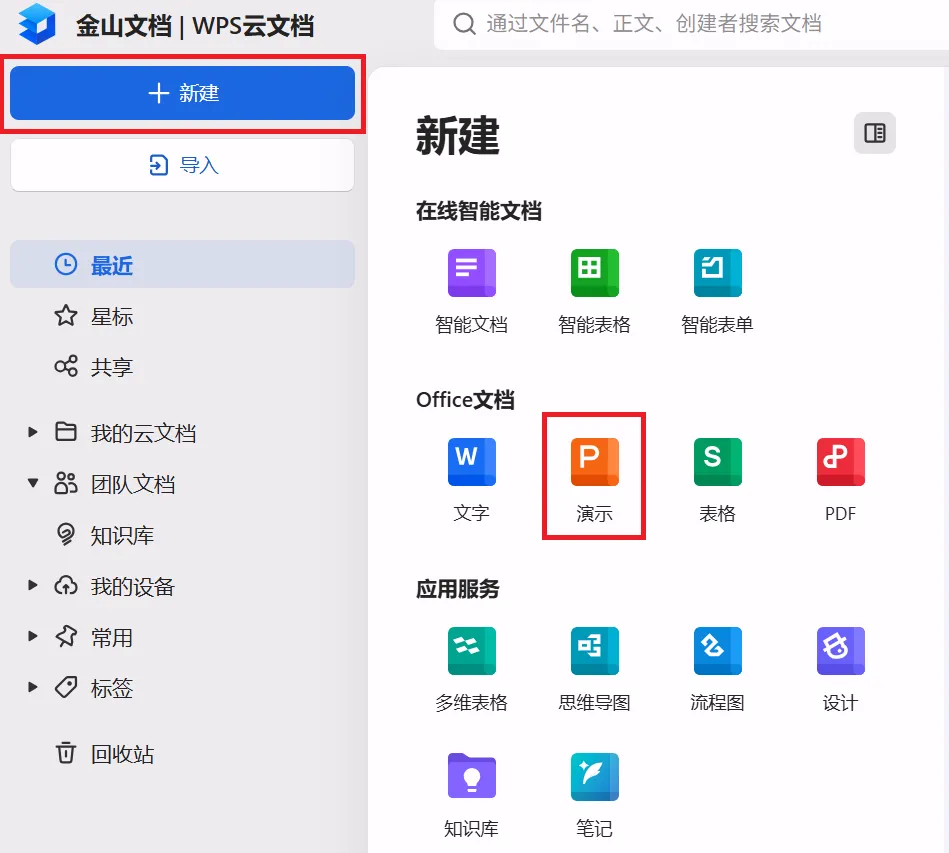
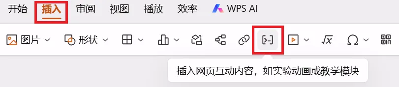
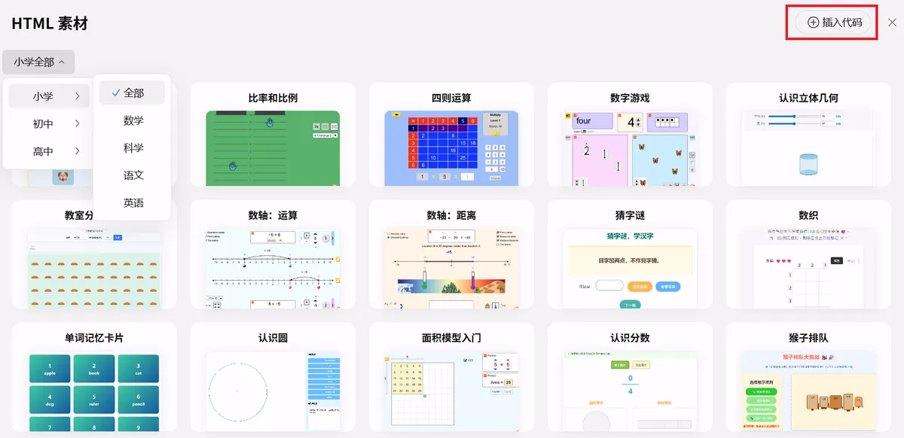
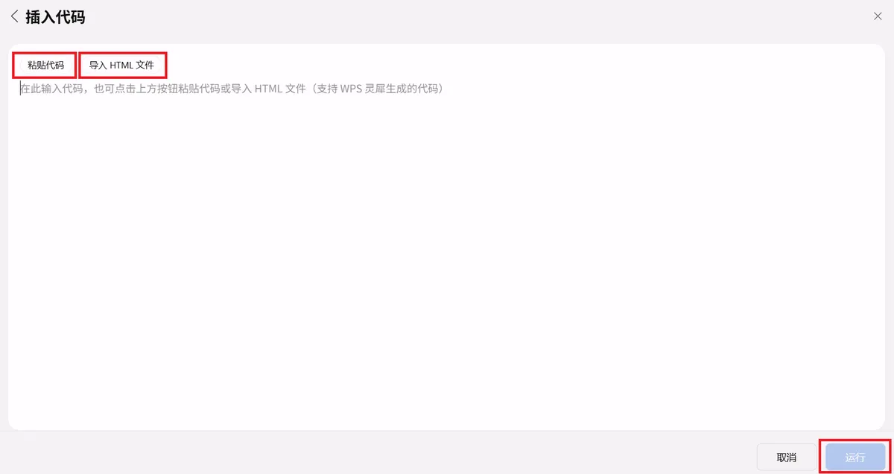
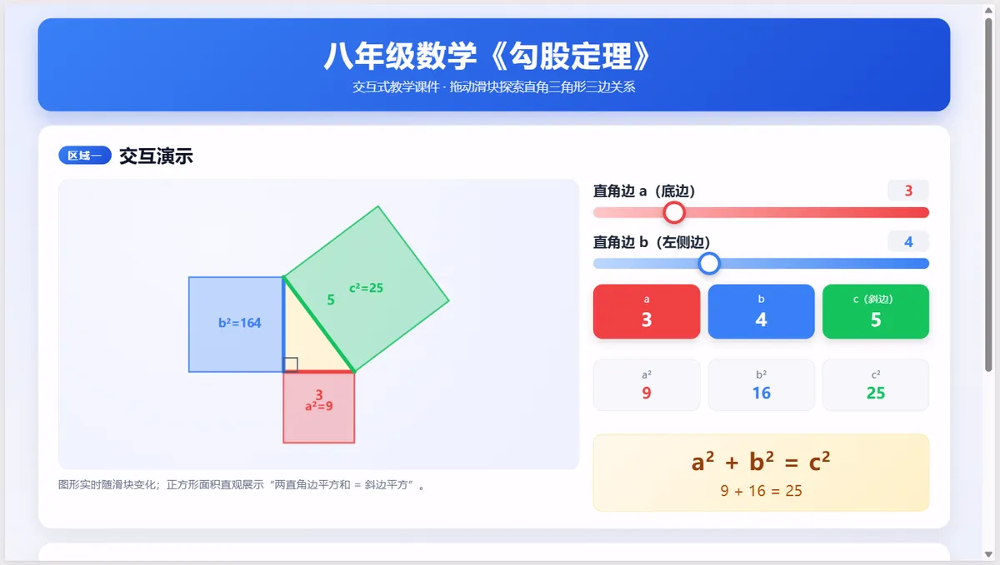
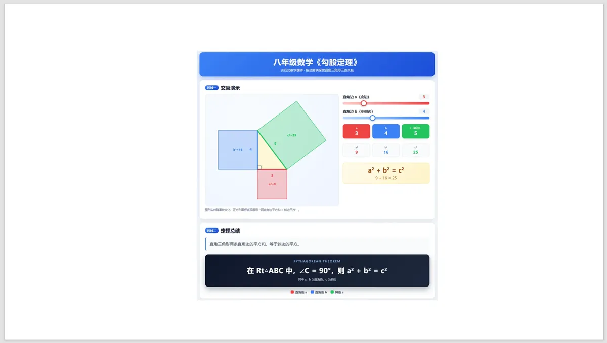
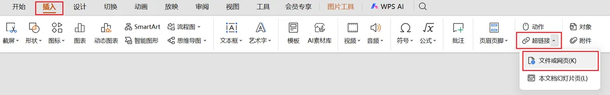
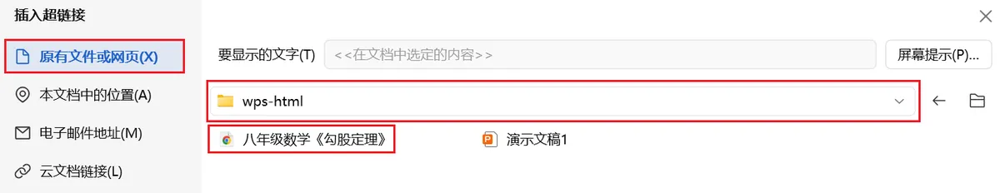

# HTML 交互式课件如何嵌入 WPS 演示？保姆级实操教程

之前给大家分享过用 WorkBuddy 一键生成 HTML 交互式课件的方法，不少老师看完后问了同一个问题：做好的 HTML 课件，能不能直接放进 WPS 演示中？又该怎么嵌入？今天这篇就把实操方法讲清楚。

## 1. HTML 课件嵌入在线 WPS 演示

[1] 登录 WPS 官网 ([wps.cn](https://www.wps.cn/))，点击【在线使用】。

[2] 点击【新建】，然后点击【演示】，新建一个空白演示或者导入本地 PPT。

[3] 点击【插入】，然后点击"插入网页互动内容，如实验动画或教学模块"按键。

[4] 点击右上角【插入代码】。

[5] 有两种方式插入 HTML 页面：【粘贴代码】或者【导入 HTML 文件】。作为示例，这里我们导入之前制作的"八年级数学《勾股定理》.html"。导入代码完毕后，点击【运行】。

[6] HTML 交互式课件已经成功嵌入 WPS 演示，并且可以直接在幻灯片内交互操作。

完成上述步骤后，HTML 交互式课件已经成功嵌入 WPS 演示中，支持直接交互，点击就能操作课件，全程不用跳出 PPT，也不用额外打开浏览器。

## 2. HTML 课件嵌入本地 WPS 客户端

[1] 在本地 PPT 幻灯片中添加文字或者图片。这里作为示例，我们添加之前制作的"八年级数学《勾股定理》.html"的一张截图作为 PPT 页面的插图。

[2] 选中文字或者图片，选择【插入】→【超链接】→【文件或网页】。

[3] 点击选择【原有文件或网页】，定位到存放 HTML 文件的文件夹，选中目标 HTML 文件后，点击【确定】。本次演示示例文件为"八年级数学《勾股定理》.html"，文件存放文件夹是"wps-html"。

[4] 幻灯片放映时，点击图片或文字，就会自动唤起浏览器打开交互课件。

这种方法支持离线使用，但是点击后会跳出 PPT，需要额外弹出浏览器窗口，容易打断课堂节奏。

## 3. 实操小提示

1. 课前务必在授课电脑提前测试，确认课件交互功能正常。
2. 在采用本地 WPS 客户端方法时，建议将 HTML 与 PPT 文件统一放在一个文件夹，便于管理，也能避免链接失效。

以上就是今天给大家分享的在 WPS 演示中插入 HTML 交互式课件的两种实操方法。如果对你备课有帮助，欢迎点赞、收藏、转发。后续我们会持续分享更多 AI 实操干货，助力大家赋能教学。