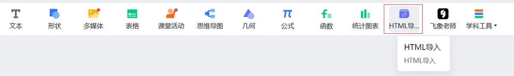
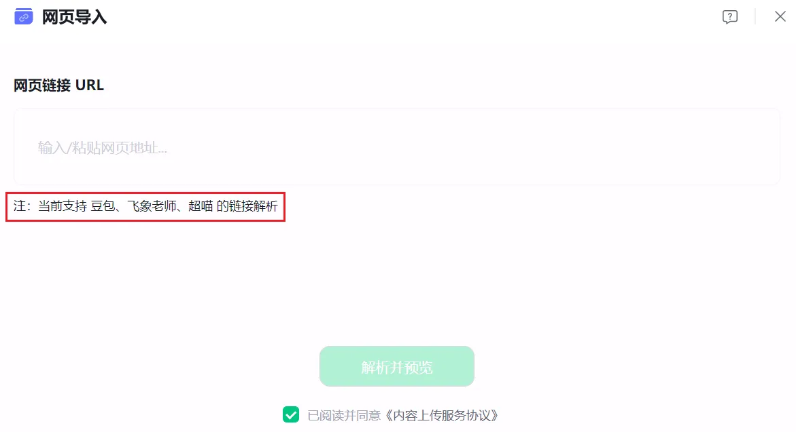
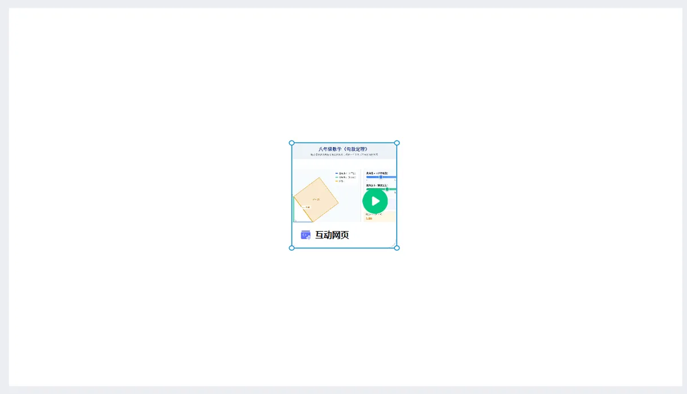
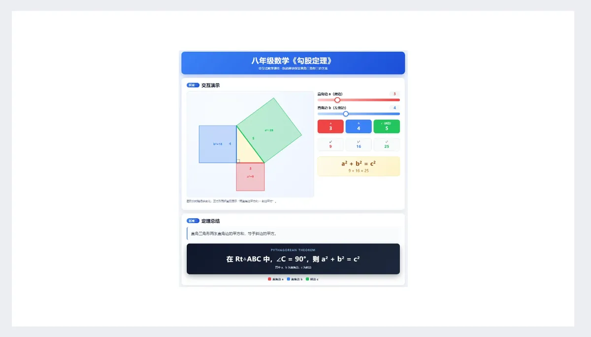
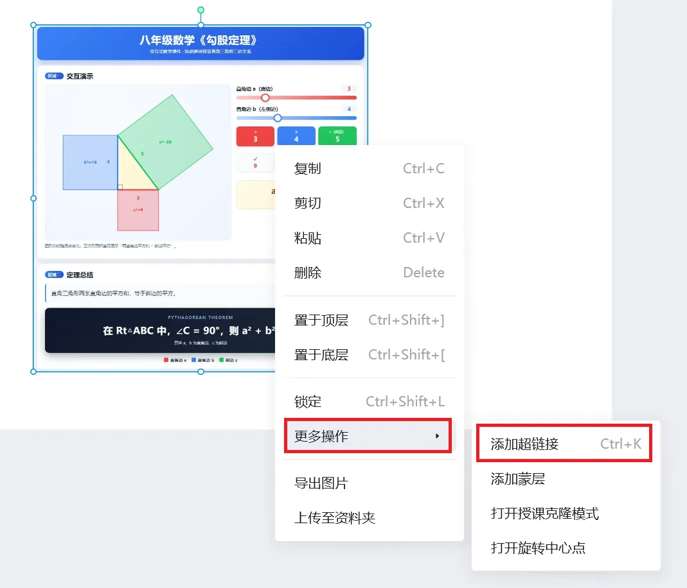
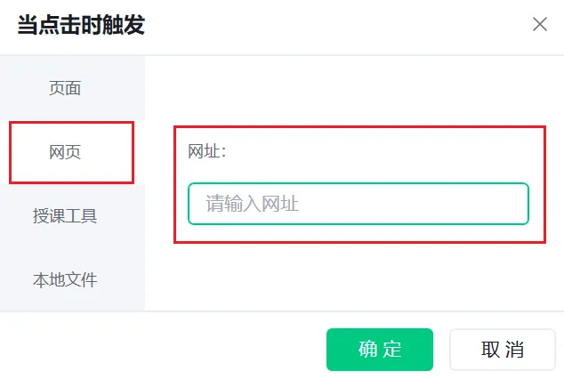
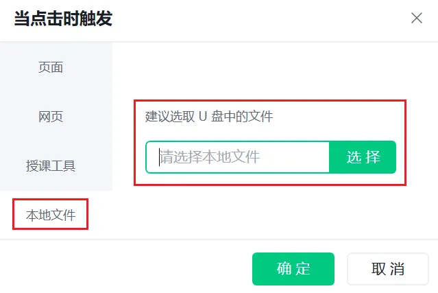

# HTML 交互式课件嵌入希沃白板

上一期我们搞定了 WPS 演示嵌入 HTML 交互课件。今天咱们换个工具，看看希沃白板要怎么操作。

## 1. 下载安装希沃白板5

[1] 登录希沃白板官网 ([easinote.seewo.com](https://easinote.seewo.com/))，点击【立即下载】，下载希沃白板5。

[2] 安装希沃白板5，完成账号注册，登录进入软件。

## 2. HTML 交互式课件嵌入希沃白板5

想把 HTML 交互式课件放进希沃白板5，主要有两种实操方案：

1. 内嵌互动网页：网页直接嵌在课件页面里，授课时不用跳出希沃白板
2. 超链接跳转：点击唤起浏览器打开网页，会跳出希沃白板

下面带来两种方案的详细实操教程。

### 2.1 内嵌互动网页

[1] 进入希沃白板的编辑页面，在顶部菜单栏找到【HTML导入】。

**重要提醒**：这个功能需要把希沃白板更新到最新版本。

[2] 在弹出的对话框中我们看到希沃白板"当前支持 豆包、飞象老师、超喵 的链接解析"。

[3] 输入/粘贴豆包、飞象老师、超喵的网页链接 URL 到输入框，然后点击【解析并预览】。这里我们以豆包生成的勾股定理交互课件作为示例，在地址输入框内填入 URL，然后点击【解析并预览】。

[4] 解析导入成功后，页面会生成网页窗口。拖动边框调整窗口尺寸，将它摆放到页面合适的位置。

[5] 授课时，点击网页窗口就能进入交互页面操作。操作完成后点击关闭，即可退回希沃白板界面。

### 2.2 超链接跳转

[1] 在希沃课件页面中，准备好用来添加超链接的文字、图形、图片等素材对象。这里作为示例，插入之前做好的"八年级数学《勾股定理》.html"的一张课件截图。

[2] 右键点击需要添加超链接的对象，依次选择【更多操作】→【添加超链接】。

[3] 添加 HTML 课件有两种方式：网页链接和本地文件。

选择网页方式，在地址框填写 HTML 文件的 URL。

选择本地文件方式，在输入框选中对应的本地文件。

[4] 进入授课模式后，点击这个素材对象，会唤起浏览器，打开 HTML 交互页面。

### 总结
两种在希沃白板插入 HTML 交互课件的方法就分享完毕。内嵌互动网页不用跳出课件，但需要联网；本地超链接支持离线使用，但点击后会弹出浏览器，离开课件页面。

大家实操过程中如果碰到什么问题，欢迎在评论区留言交流！