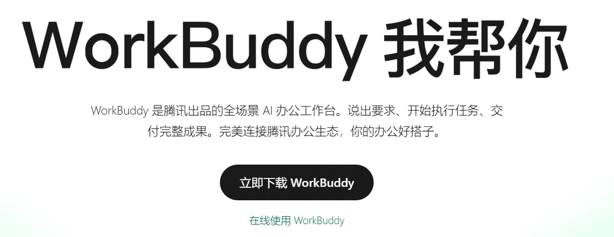
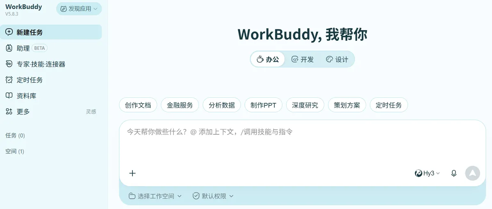
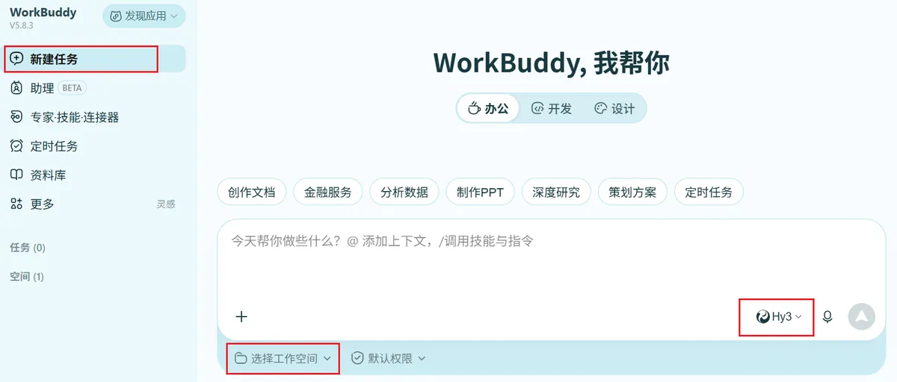
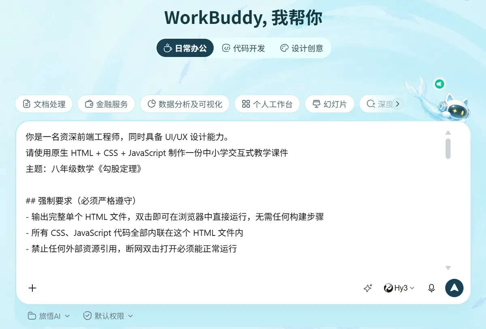
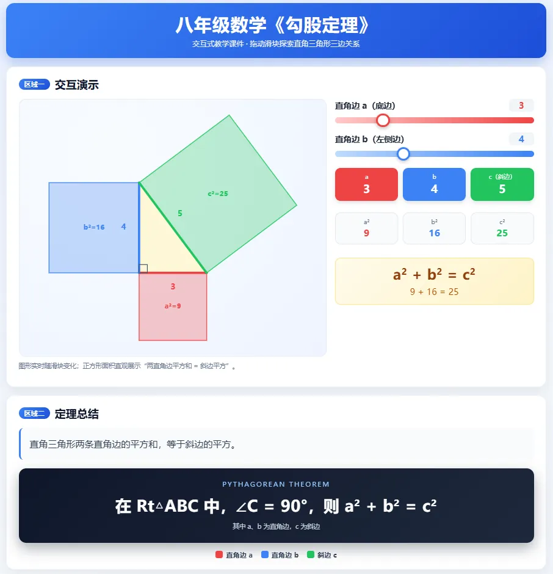

# 不写代码也能做 HTML 交互式课件？WorkBuddy 完整制作流程（附提示词）

不会写代码、不会做动画，能不能做出 HTML 交互式课件？答案是可以的。今天，我们用 WorkBuddy 来制作 HTML 交互式课件，把完整流程拆给你看，新手也能跟着做。

## 1. 什么是"HTML 交互式课件"?

`HTML 交互式课件`是指以 HTML 网页形式制作，用浏览器就能直接打开运行的课件。它不只是静态展示文字和图片，而是内置交互逻辑，如拖拽、滑块、点击翻页、即时判分等，可实现图形拖拽、参数调节、动态演示、即时答题结果反馈等实时效果。

HTML 交互式课件是独立的单网页课件，和 PPT 有根本的区别。传统 PPT 需安装 Office, WPS 等软件才能打开，操作时需要点一下翻一页，学生只能被动的观看。而 HTML 交互式课件本质上是一个网页文件，通过浏览器打开就能直接用，不需要安装任何软件，支持本地离线使用。学生能够主动的动手操作，并且可以看到实时反馈。

过去做这种 HTML 交互式课件通常需要会写代码，但如今借助 AI 工具（如 WorkBuddy），老师只需用自然语言描述需求，就能快速生成一个专业级的交互课件。

## 2. 交互式课件应用场景

HTML 交互式课件可灵活用于多种教学场景，贯穿课前、课中、课后全教学流程：课前预习、课堂演示、随堂测评、课堂小结、课后复习等等。

## 3. 实操流程

接下来，我们以八年级数学《勾股定理》为例，手把手讲解如何用 WorkBuddy 制作交互式 HTML 课件，零基础新手也能直接跟着操作。

### 3.1 安装并登录 WorkBuddy

1. 首先，打开 WorkBuddy 官网 ([workbuddy.cn](https://www.workbuddy.cn/))，点击【立即下载 WorkBuddy】，下载 WorkBuddy 客户端。

<div align="center">
   
   <p>下载 WorkBuddy</p>
</div>

2. 下载完成后，安装 WorkBuddy 客户端。

3. 安装完成后，打开并登录 WorkBuddy。

<div align="center">
   
   <p>WorkBuddy 客户端界面</p>
</div>

WorkBuddy 客户端初始界面左侧是任务侧边栏，中间为对话交互区；生成任务产物后，可在对话区右侧的成果预览区实时查看效果。

### 3.2 新建任务

点击【新建任务】，在【选择工作空间】栏选定对应工作空间，再为此任务挑选适配模型，请根据自身任务需求选择合适模型，本次演示我们选用腾讯混元【Hy3】模型。

<div align="center">
   
   <p>WorkBuddy 新建任务</p>
</div>

### 3.3 输入提示词

工作空间、模型等基础配置选择完成后，输入提示词，点击运行，WorkBuddy 就开始工作了。

<div align="center">
   
   <p>输入提示词</p>
</div>

本文以八年级数学《勾股定理》为演示案例，下方为完整提示词，制作同类课件可在此基础上参照修改。

```
你是一名资深前端工程师，同时具备 UI/UX 设计能力。
请使用原生 HTML + CSS + JavaScript 制作一份中小学交互式教学课件
主题：八年级数学《勾股定理》

## 强制要求（必须严格遵守）
- 输出完整单个 HTML 文件，双击即可在浏览器中直接运行，无需任何构建步骤
- 所有 CSS、JavaScript 代码全部内联在这个 HTML 文件内
- 禁止任何外部资源引用，断网双击打开必须能正常运行

## 标题
`八年级数学《勾股定理》`

## 界面与绘图规范
- UI风格：中小学数学课堂风格，配色清爽简洁，字体清晰，适合教室投影、全屏演示
- 图形绘制统一使用 Canvas 2D
- 所有绘制坐标通过统一缩放系数自动换算，图形自适应画布大小，保证所有图形元素始终完整落在画布可视区域内，不出现溢出截断

## 页面布局
请使用 Flex / Grid 布局，页面自上而下分为两大区域，用明显的卡片式分区：
- 区域一【交互演示】
- 区域二【定理总结】

## 交互演示区

### 图形绘制
- 在 Canvas 中绘制一个可视化直角三角形，直角位于左下角，两条直角边分别水平（a，底边）与竖直（b，左侧边）
- 三角形内部填充浅色，直角处绘制标准直角符号（小方块），三条边用不同颜色区分并标注边长数值
- 在三角形三条边外侧分别绘制对应的正方形，颜色半透明以不遮挡三角形

### 滑块控制
- 提供两个滑块，拖动滑块可实时修改直角边 a、b 的长度
- 滑块取值范围：a ∈ [1, 10]、b ∈ [1, 10]

### 数值展示
- 初始值：a = 3、b = 4
- 斜边长度按 c = sqrt(a²+b²) 计算，保留 2 位小数显示
- 实时计算并展示三角形三条边的边长数值：a、b、c
- 实时计算并展示三个正方形面积：a²、b²、c²（保留 1~2 位小数）
- 在图形下方动态展示等式：a² + b² = c²
- 拖动滑块时，图形与文字实时刷新

## 定理总结区
- 展示勾股定理完整文字描述：`直角三角形两条直角边的平方和，等于斜边的平方。`
- 展示勾股定理数学公式，用带样式的公式卡片展示：
   `在 Rt△ABC 中，∠C = 90°，则 a² + b² = c²`

## 体验优化
- 控件大小适配投影观看，滑块、按钮尺寸不要过小

## 交付要求
- 只返回完整的单个 HTML 代码文件
- 输出 HTML 文件名：标题 + ".html"
```

### 3.4 查看产物

WorkBuddy 执行完成任务后，将输出产物：`八年级数学《勾股定理》.html`。本次按照提示词要求，仅生成单文件 HTML 课件，无需额外依赖资源，可直接用浏览器打开预览、使用。

<div align="center">
   
   <p>WorkBuddy 输出产物</p>
</div>

点击产物 `八年级数学《勾股定理》.html`，即可在右侧成果预览区直接查看交互式课件效果，实时验证页面的交互功能。

<div align="center">
   
   <p>HTML 交互式课件</p>
</div>

### 3.5 继续调整

如需调整课件内容，直接在 WorkBuddy 对话区提交修改需求即可。你可以指令调整交互效果、更换配色等，WorkBuddy 会基于原有成果迭代优化，重新输出 HTML 文件；也可以直接编辑源码做细节微调，这两种方式可灵活选用。

## 总结
以上就是借助 WorkBuddy 制作交互式 HTML 课件的完整实操流程。从新建任务、选定模型、输入提示词，到预览成品、迭代调整，全程无需复杂代码基础，一线老师也能快速上手，制作带交互效果的课件。

你有没有体验过用 WorkBuddy 制作交互式课件？日常备课，你最需要哪一类互动课件？欢迎大家在评论区留言交流！