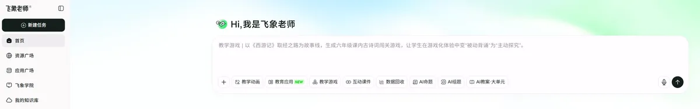
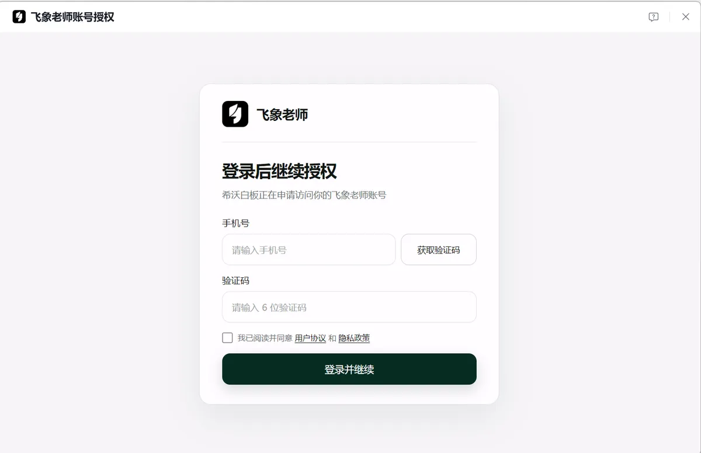
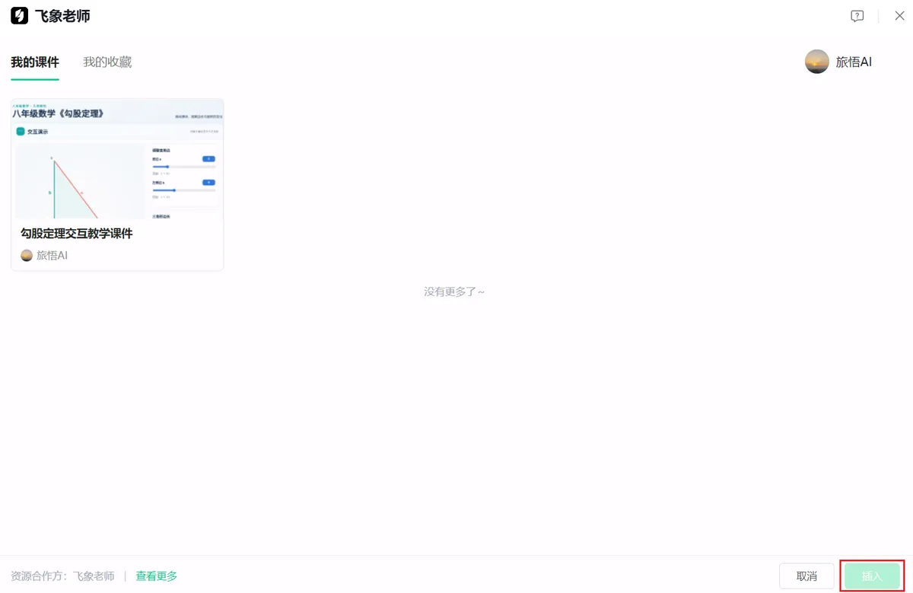

# 在希沃白板中插入飞象老师

在希沃白板里插入飞象老师课件，一共分为三步：

1. 在飞象老师平台制作课件
2. 在希沃白板中插入飞象老师课件
3. 课堂授课时播放

接下来为大家讲解详细操作步骤。

## 1. 操作步骤

### 1.1 飞象平台制作课件

登录飞象老师平台（[https://www.feixianglaoshi.com/](https://www.feixianglaoshi.com/)），制作互动课件。

### 1.2 在希沃白板中插入飞象老师课件

[1] 在希沃白板5 编辑栏点击【飞象老师】。

小提示：请先将希沃白板5 更新至最新版。

[2] 完成飞象老师账号的登录与授权。

[3] 在课件列表中找到目标课件，点击【插入】。

[4] 进入授课模式，点击即可交互。

## 结语

今天分享的这个方法无需复制链接，就能将飞象老师丰富的教学资源和希沃白板的授课优势相融合，轻松打造趣味课堂，老师们快去试试吧！
